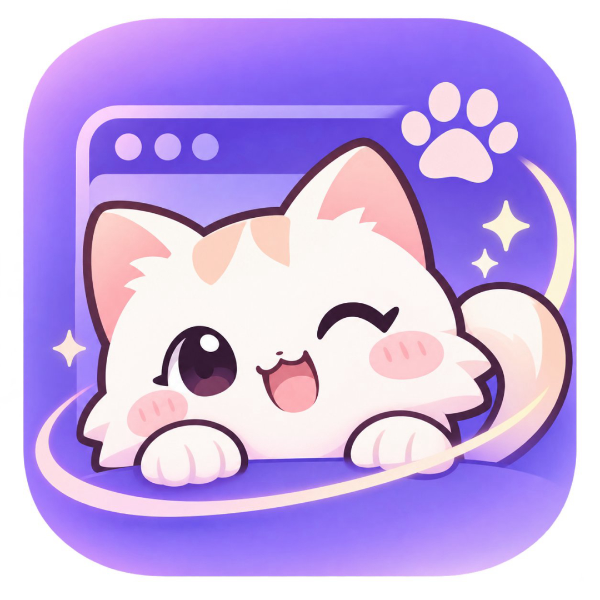
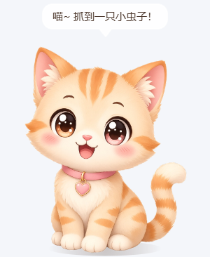

<div align="center">
  
  <h1>CuteCat</h1>
  <p>桌面上的小橘猫：透明置顶、拖来拖去、点一下会有反应。</p>
  <p>
    
  </p>
</div>

---

## 下载与安装

发行版页面：[github.com/hbxdss/CuteCat-One/releases](https://github.com/hbxdss/CuteCat-One/releases)

| 形态 | 文件 | 说明 |
| --- | --- | --- |
| 安装包 | `CuteCat-Setup-1.0.1.exe` | 装到 `Program Files`，带开始菜单项、卸载程序和可选开机自启 |
| 绿色版 | `CuteCat-win64.zip` | 解压即用，不写系统目录，适合放 U 盘或换机器直接带走 |

两者都是 64 位，支持 Windows 10 / 11。装完双击猫就出现在屏幕右下角，点它会有反应，按住能拖走。

## 这是什么

CuteCat 是一个 Windows 桌宠，按仓库里的《技术栈方案.md》实现：

| 角色 | 选型 | 在本项目里干什么 |
| --- | --- | --- |
| 语言 | C++17 | 全部主体逻辑 |
| UI 框架 | Qt 6.5+（LTS，实测 6.7.2） | 透明置顶窗口、托盘、鼠标交互、绘制 |
| 构建系统 | CMake 3.20+ | 工程配置，Visual Studio 2022 生成器 |
| 动画 | rlottie（可选接入） | Lottie 逐帧播放；未接入时用图片皮肤的程序化动画 |
| 配置 | QJson（Qt 自带） | 读写 `%LOCALAPPDATA%\hbxdss\CuteCat\config.json` |
| 打包 | windeployqt | `scripts\package.bat` 生成绿色版 |

不引入任何 Web 技术栈：桌宠要 24 小时挂着，Electron/Tauri 的内存不划算。

## 当前版本能做什么

- 透明、无边框、置顶的小窗，只有猫本体挡鼠标（点透明区域不会误拖）
- **会呼吸**：胸腔起伏以脚底为锚点，整只猫不会上浮
- **待机轻摆**：缓慢左右晃，像在打盹
- **鼠标拖拽**：按住拖动，拖拽时按速度轻微倾斜，松手回正
- **点击有反应**：Q 弹一下 + 飘心/闪光粒子 + 随机气泡（“喵~”“抓到一只小虫子！”……）
- **滚轮调大小**、右键菜单（总在最前 / 鼠标穿透 / 大小 / 记住位置 / 开机自启 / 重新加载形象 / 退出）
- **托盘常驻**：关窗口只是躲起来，退出走托盘菜单
- **配置持久化**：大小、位置、置顶、穿透、透明度、帧率、自启
- 单实例运行：重复启动不会变成两只猫

## 目录结构

```text
CuteCat/
├── CMakeLists.txt          # 构建配置（Qt6 + C++17 + 可选 rlottie）
├── src/
│   ├── main.cpp            # 入口：单实例、命令行、创建窗口
│   ├── pet.h / pet.cpp     # 桌宠窗口：窗口属性、交互、托盘、菜单
│   ├── config.h / config.cpp   # QJson 配置读写与范围校验
│   ├── animation/
│   │   ├── pet_skin.h      # 皮肤接口（tick / paint / hitTest）
│   │   ├── image_skin.*    # 图片皮肤：呼吸、挤压、弹跳、粒子
│   │   ├── lottie_skin.*   # rlottie 皮肤（可选编译）
│   │   └── skin_factory.*  # 按配置选皮肤，失败自动退回图片
│   └── main.js             # 建仓时的占位文件（历史保留）
├── resources/
│   ├── config.json         # 默认配置（内置到 qrc）
│   ├── pet/cat_idle.png    # 默认形象（512×512 透明 PNG）
│   └── lottie/             # Lottie 动画投放口
├── scripts/
│   ├── build.bat           # 一键编译
│   ├── run.bat             # 启动已编译的 exe
│   └── package.bat         # windeployqt 打包绿色版
├── tools/                  # 抠图/预览用的小脚本（纯标准库）
└── 技术栈方案.md            # 技术选型说明
```

## 编译与运行

前置（本机已装齐）：

1. Qt 6.5+（实测 `C:\Qt\6.7.2\msvc2019_64`）
2. Visual Studio 2022 生成工具（MSVC + Windows SDK）
3. CMake 3.20+

一条命令搞定：

```bat
scripts\build.bat
scripts\run.bat
```

或者手动：

```bat
call "C:\Program Files (x86)\Microsoft Visual Studio\2022\BuildTools\VC\Auxiliary\Build\vcvars64.bat"
cmake -S . -B build -G "Visual Studio 17 2022" -A x64 -DCMAKE_PREFIX_PATH=C:\Qt\6.7.2\msvc2019_64
cmake --build build --config Release --parallel
build\bin\Release\CuteCat.exe
```

Qt 装在别处时，先 `set QT_DIR=D:\Qt\6.7.2\msvc2019_64` 再跑脚本。

### 一帧截图自检

不启动界面也能验证绘制是否正常（CI 或调样式时好用）：

```bat
build\bin\Release\CuteCat.exe --snapshot snapshot.png
```

## 配置

首次运行会把默认配置写到 `%LOCALAPPDATA%\hbxdss\CuteCat\config.json`（右键菜单 →「关于 CuteCat」里也能直接看到完整路径）：

```json
{
  "window": {
    "width": 300,
    "height": 366,
    "keepOnTop": true,
    "clickThrough": false,
    "rememberPosition": true
  },
  "appearance": {
    "opacity": 1.0,
    "animation": "image",
    "image": "",
    "lottie": ":/lottie/idle.json"
  },
  "behavior": {
    "autoStart": false,
    "frameRate": 60
  }
}
```

- `window.width`：160–640，高度按 1.22 倍自动算（上面那条留给说语气泡）
- `appearance.image`：留空用内置形象；也可以填自己的 PNG 绝对路径
- `appearance.animation`：`image` 或 `lottie`
- 改完配置后，托盘菜单 →「重新加载形象」

## 换形象

替换 `resources/pet/cat_idle.png` 即可：

- 正方形、透明背景，建议 512×512 或更大
- 猫的脚底尽量贴图片底边，别留大片空白，否则“呼吸”锚点会偏
- 换完重新编译（图片被打进 qrc）

## 接入 rlottie（可选）

默认不带 rlottie，桌宠用图片皮肤就能跑。要上 Lottie：

1. 编译 rlottie（Airbnb 开源，CMake 工程），装到一个能找到的位置
2. `cmake -S . -B build -G "Visual Studio 17 2022" -A x64 -DCMAKE_PREFIX_PATH="C:\Qt\6.7.2\msvc2019_64;C:\rlottie\install" -DCUTECAT_WITH_RLOTTIE=ON`
3. 把 `.json` 动画放进 `resources/lottie/` 并加进 `CMakeLists.txt` 的资源列表
4. `config.json` 里把 `appearance.animation` 改成 `lottie`，`lottie` 指向文件

细节见 `resources/lottie/README.md`。加载失败会自动退回图片皮肤，不会白屏。

## 已知边界

- 只在 Windows 上验证过（透明窗口 + 托盘 + 注册表自启都是 Windows 行为）
- 鼠标穿透打开后只能从托盘菜单关掉，这是有意的，避免点不到猫
- 形象目前是一张静态图 + 程序化动画，没有眨眼/口型；等 Lottie 素材到位再补

## 许可

AGPL-3.0，见 [LICENSE](LICENSE)。